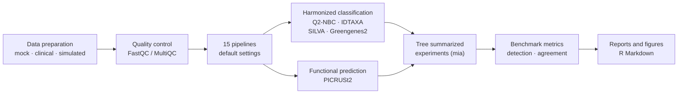
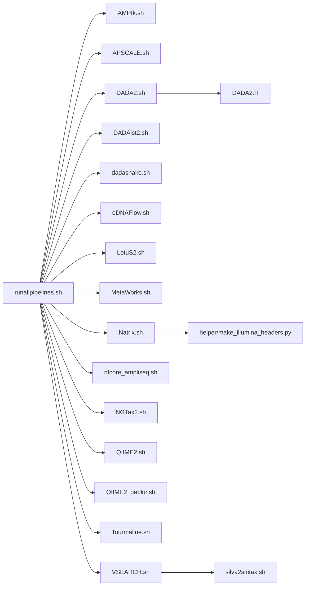
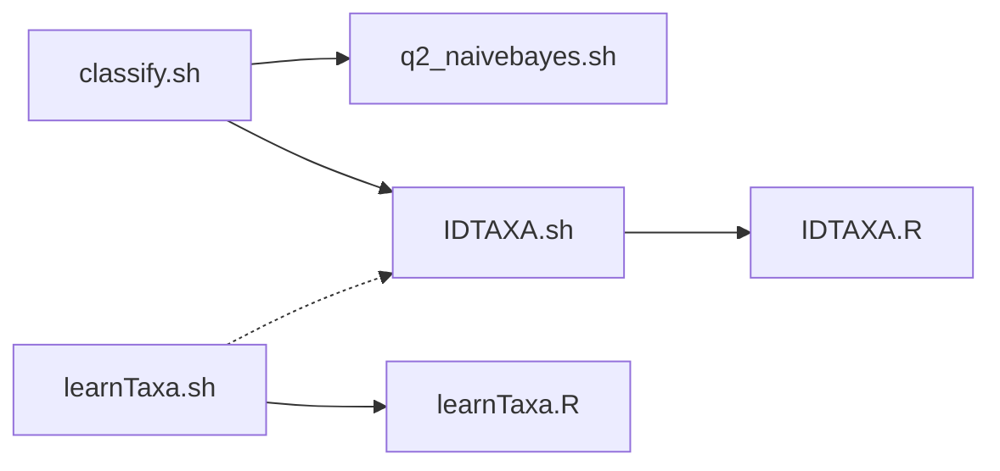
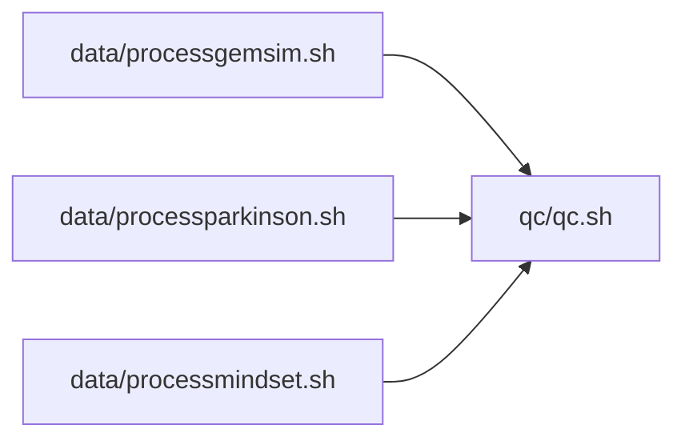
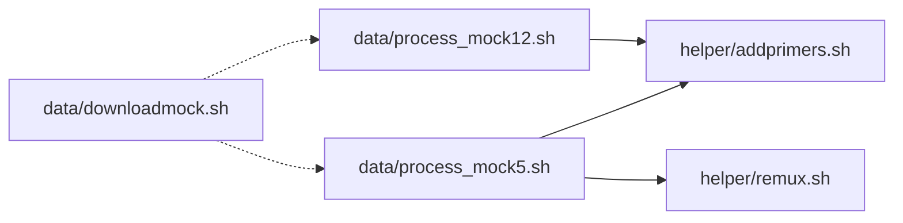
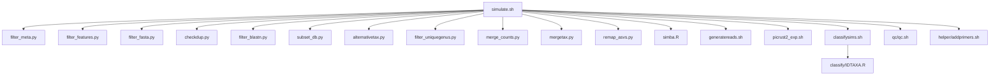
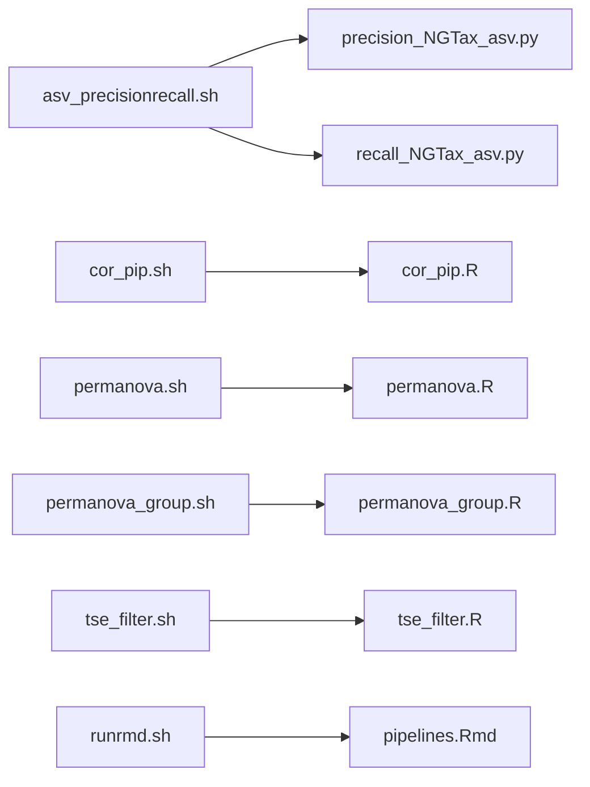
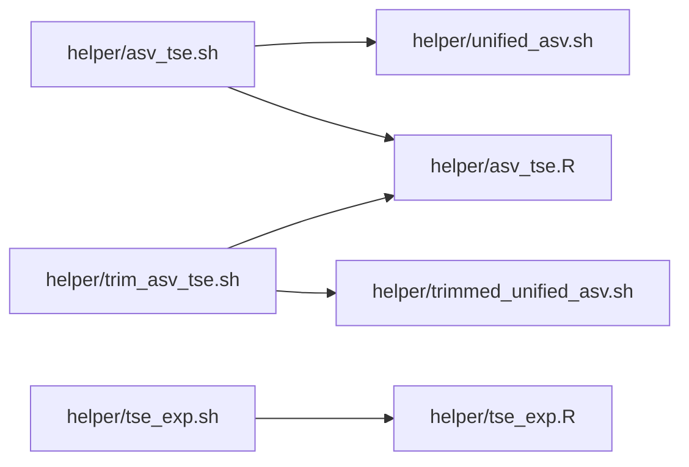
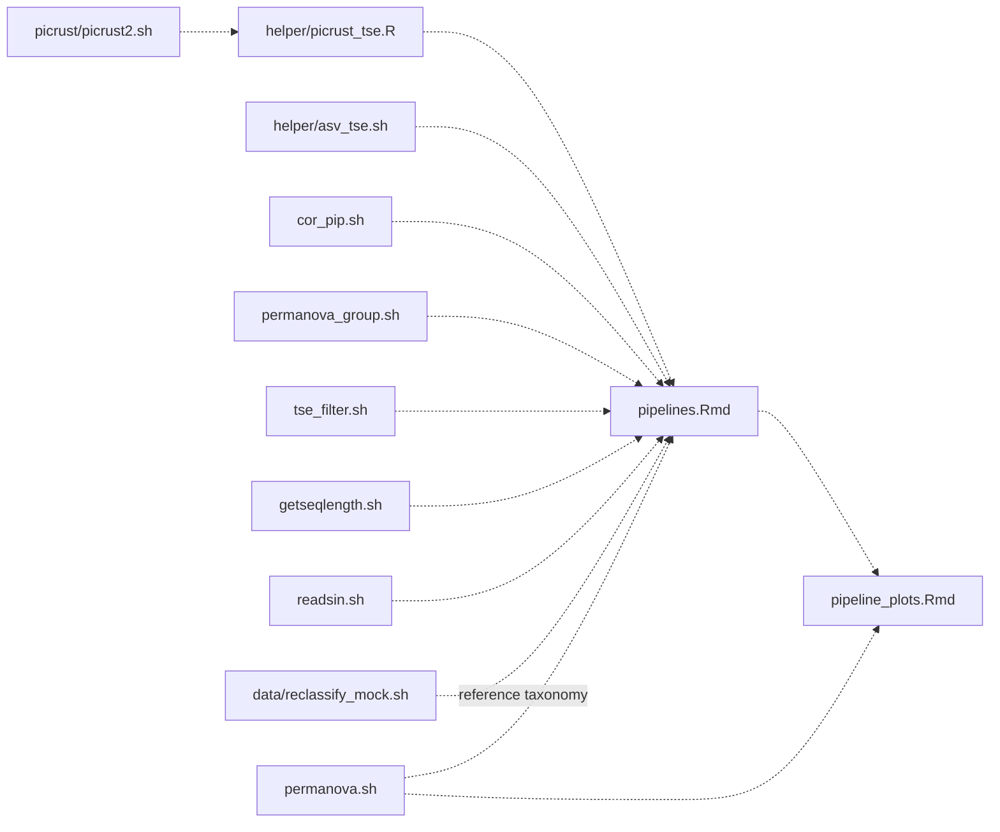

# When Pipelines Matter (and When They Do Not)

Analysis code for:

> Mulder D, Natasha EE, Bastiaanssen T, Gosepa G, Szopinska-Tokov J, Poelmans G, Bloemendaal M, Homberg JR, Arias Vasquez A. *When Pipelines Matter (and When They Do Not): Benchmarking 16S rRNA Gene Bioinformatic Pipelines for Human Gut Microbiome Analysis.* (in preparation) · 

The scripts are shared for transparency, to show how each step in the benchmark was carried out. They were written for the Snellius cluster with hard-coded paths and settings.

Code archive: 10.5281/zenodo.23767633

Data archive: 10.5281/zenodo.23597756

## Workflow

## Structure

| Folder | Contents |
|---|---|
| `data/` | Processing mock communities (Mock 5, Mock 12): download, demultiplexing, primers, re-multiplexing and SILVA v138 reference taxonomy. Clinical cohorts (GEMSIM, MINDSet, Parkinson's) |
| `simulation/` | In silico communities, implanted group differences, chimeras and sequencing errors |
| `qc/` | FastQC/MultiQC |
| `pipelines/` | One script per pipeline; `runallpipelines.sh` submitted them all with the same settings |
| `classify/` | Harmonized classification (Q2-NBC, IDTAXA) |
| `picrust/` | PICRUSt2 functional prediction |
| `helper/` | Primers, re-multiplexing, creating combined `TreeSummarizedExperiment` objects |
| `benchmark/` | Benchmark metrics; statistical analyses and figures (`pipelines.Rmd`, `pipeline_plots.Rmd`) |

## Script dependencies

Solid arrows: one script calls another. Dashed arrows: a script reads files written by another.

### Running the pipelines

### Taxonomic classification

### Data preparation and QC

### Mock communities

### Simulation

### Benchmarking

### Building the summarized experiments

### Inputs to the R Markdown reports

## Data availability

- Mock communities: [Mockrobiota](https://github.com/caporaso-lab/mockrobiota)
- Parkinson's cohort: NCBI SRA [PRJNA601994](https://www.ncbi.nlm.nih.gov/bioproject/PRJNA601994) (dataset 2)
- Simulated datasets, pipeline outputs for all datasets (including the clinical cohorts) and benchmark metrics: [10.5281/zenodo.23597756](https://doi.org/10.5281/zenodo.23597756)
- MINDSet and GEMSIM raw sequences and clinical metadata: closed access in the Radboud Data Repository [link], available on request through [contact]
